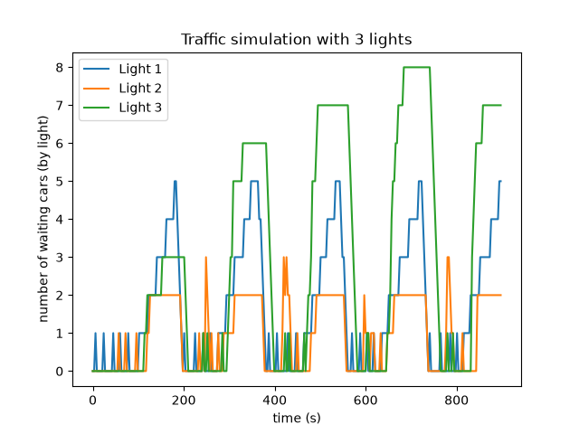
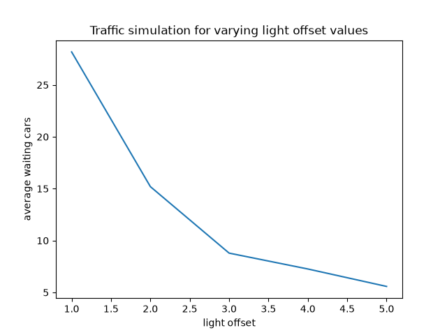
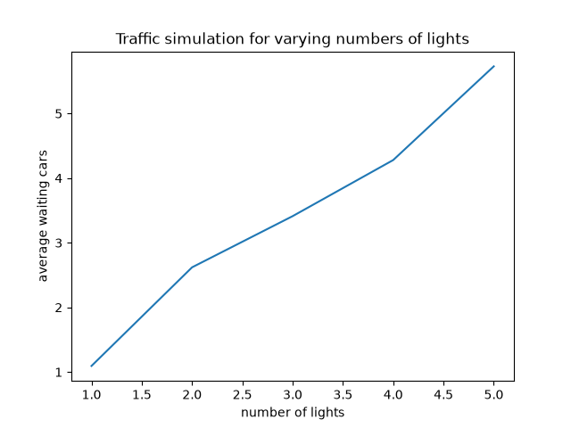
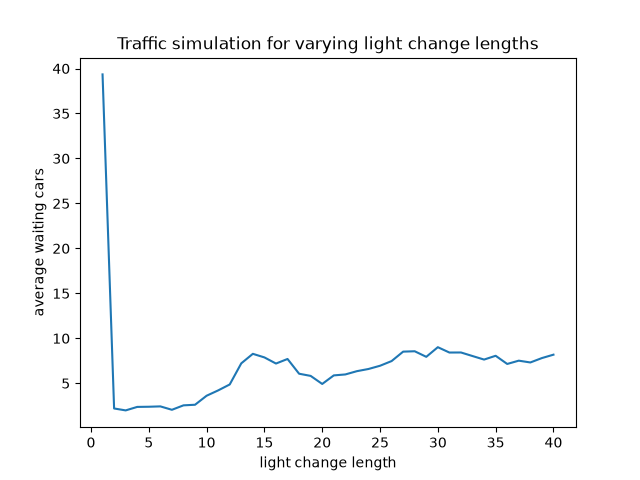
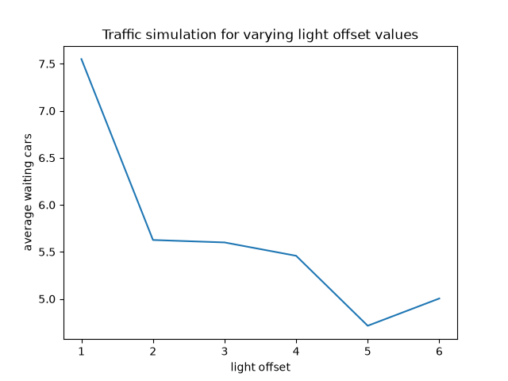

# Traffic Flow Simulation

A discrete-event traffic intersection and corridor simulation built in Python using object-oriented programming. The model simulates vehicles traveling through a configurable sequence of synchronized or offset traffic lights, accounting for driver reaction delays, variable vehicle speeds, and stochastic arrival rates—paired with Matplotlib data visualizations analyzing queue dynamics and congestion bottlenecks.

## Project Structure

- **`simulation.py`** — Core simulation engine modeling `Light`, `Car`, and `Simulation` objects across discrete 3-second timesteps.
- **`graph.py`** — Parameter sweep and visualization script generating plots across varying traffic densities, light counts, signal cycle lengths, and signal offsets.
- **`matplotlib_test.py`** — Visualization setup and test script.

## How It Works

The simulation advances in discrete timesteps (each representing **3 seconds** of real time) across three core classes:

- **`Light`**: Manages red/green signal cycles, countdown timers, a FIFO vehicle queue, and a 1-timestep driver reaction delay after turning green before the first queued car can accelerate.
- **`Car`**: Tracks each vehicle's state (traveling vs. queued at an intersection), remaining lights on its route, and randomized inter-light travel times.
- **`Simulation`**: Orchestrates the multi-light corridor, configures offset signal timing ("green wave" synchronization), spawns incoming vehicles at randomized intervals, and tracks system-wide waiting car counts.

## Simulation Results & Analysis

### Queue Length Over Time


### Traffic Density Impact


### Signal Timing & Corridor Parameters
| Light Count | Signal Cycle Length | Light Offset |
| :---: | :---: | :---: |
|  |  |  |

## Getting Started

### Prerequisites
- Python 3.10+
- `matplotlib` (required only for running `graph.py`)

### Running the Simulation
```bash
git clone [https://github.com/kamohelo67/traffic-flow-simulation.git](https://github.com/kamohelo67/traffic-flow-simulation.git)
cd traffic-flow-simulation
python simulation.py
